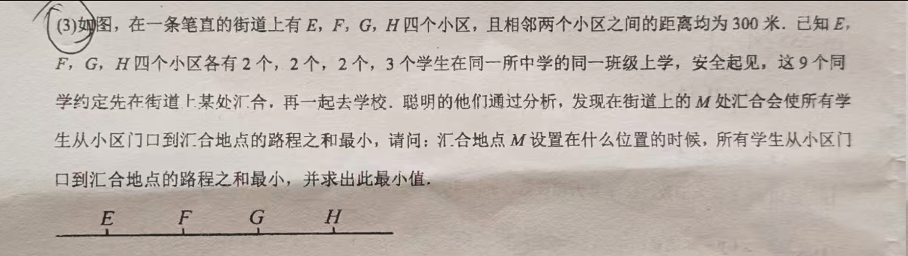
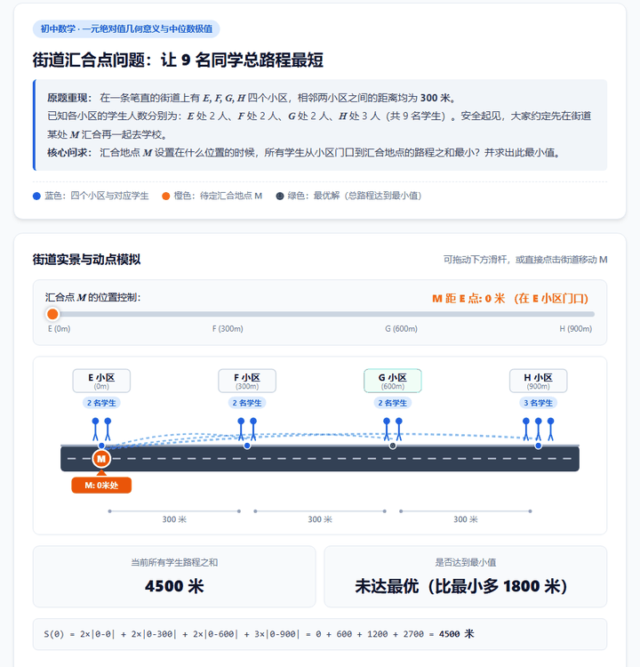

[English](README.md) | 中文

## math-teaching-animation（Agent Skills 技能包）

把数学知识点或作业题做成可交互动画教学 HTML 的技能，遵循 Agent Skills 开放标准（一个含 SKILL.md 的文件夹）。适用于 Antigravity、Claude Code、Codex、Gemini CLI、Cursor 等支持 SKILL.md 的客户端，不只限于 Antigravity。

## 安装

通用办法：克隆本仓库，把整个文件夹复制到你所用客户端的 skills 目录，重启 agent 会话。

```bash
git clone https://github.com/leethoneid/math-teaching-animation.git
```

安装命令（按客户端选一条，复制的是整个文件夹）：

```bash
# Antigravity（全局）
mkdir -p ~/.gemini/antigravity/skills
cp -r math-teaching-animation ~/.gemini/antigravity/skills/
# Claude Code（全局）
mkdir -p ~/.claude/skills
cp -r math-teaching-animation ~/.claude/skills/
# Codex（全局）
mkdir -p ~/.codex/skills
cp -r math-teaching-animation ~/.codex/skills/
# Gemini CLI（全局）
mkdir -p ~/.gemini/skills
cp -r math-teaching-animation ~/.gemini/skills/
# 仅当前项目（以 Antigravity 为例）
mkdir -p .agents/skills
cp -r math-teaching-animation .agents/skills/
```

| 客户端 | 全局（整机通用） | 仅当前项目 |
| --- | --- | --- |
| Antigravity | `~/.gemini/antigravity/skills/` | `.agents/skills/` |
| Claude Code | `~/.claude/skills/` | `.claude/skills/` |
| Codex | `~/.codex/skills/` 或 `~/.agents/skills/` | `.codex/skills/` 或 `.agents/skills/` |
| Gemini CLI | `~/.gemini/skills/` | `.gemini/skills/` |
| Cursor | —（仅项目级） | `.cursor/skills/` |
| Muse | 工作区 `custom-skills/` 目录 | — |

注意三点：复制的是整个文件夹（里面含 SKILL.md 与 assets），不要只拷 SKILL.md 一个文件；个别版本的 Antigravity 改读 `~/.agents/skills`，上面那条路装完没生效就换这个目录；装完重启 agent 会话，技能在会话启动时扫描。

更新：进克隆目录 `git pull` 后重新复制即可。

## 使用方法

装完重启会话后，直接用自然语言提需求，技能按 SKILL.md 的规矩生成单个离线可用的 HTML 教学页：

- 概念讲解：“用动画讲一下完全平方公式”
- 题目讲评：直接贴一道题，让 agent 按技能出动画页

显式调用（按需，不必须）：Claude Code 用 `/math-teaching-animation`，Codex 用 `$math-teaching-animation`；其他客户端直接提需求即可，技能按描述自动触发。

成品标准：单个自包含 HTML 文件，双击即可在浏览器打开，不需要构建步骤，不需要登录，不需要联网；含播放、暂停、单步前进、单步后退、重置五类控件和改关键参数的滑杆；配色全页统一，已知量蓝色、未知量橙色、结论绿色。

## 示例





- 上面第一张是题目原文，第二张是动画效果；复现提示词见 `meeting-point-prompt.md`：把提示词发给装好本技能的 agent，即可生成同类页面。
- 本包 `assets/example-meeting-point.html`：汇合点最小路程问题（街道四个小区、加权路程和最小），直接用浏览器打开就能看成品效果，对照讲法与实现。
- 概念例：“用动画讲一下完全平方公式”→ 面积模型＋滑杆改 a、b，看 (a+b)² 如何展开。

## 包内容

- `SKILL.md`：技能正文（带 name 与 description 的 frontmatter）
- `assets/example-meeting-point.html`：完整示例，汇合点最小路程问题
